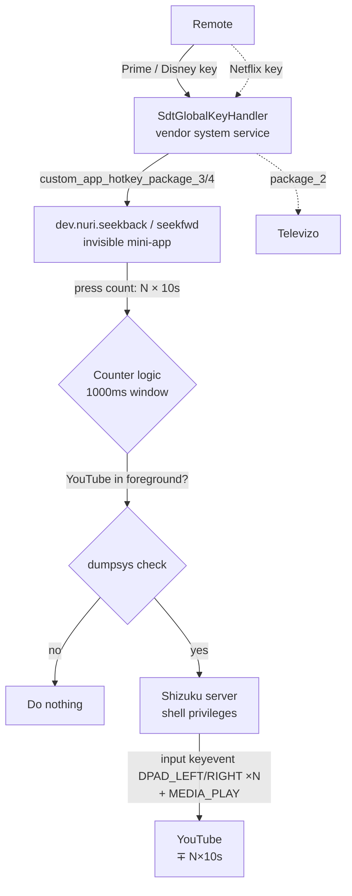

# Technical Documentation

> **Türkçe:** [TEKNIK.md](TEKNIK.md)

This document explains how the project works for technical users: the vendor key mechanism, the discovery method, architectural choices and how to build the APKs from source.

Test device: **Skyworth UHD Google TV STB** (`HPR314-Next`/`RMQ`), Android 14.

## 1. Vendor shortcut key mechanism

The branded remote keys do not travel the standard Android input path — accessibility services **cannot see them** (they can't be captured with Key Mapper/Button Mapper). The keys drop straight from the hardware layer into a broadcast:

- System APK: `/system/priv-app/SdtGlobalKeyHandler/SdtGlobalKeyHandler.apk`
- Receiver: `com.sdt.globalkey/.GlobalKeyReceiver`
- Intent action: `android.intent.action.GLOBAL_BUTTON`
- KeyEvent extra: `android.intent.extra.KEY_EVENT`
- Logcat tag: `SdtGlobalKey`

The handler looks up the user assignment for the pressed keyCode; if there is no assignment it launches the built-in fallback app:

| KeyCode | Slot setting | Fallback |
|---|---|---|
| 265 | `custom_app_hotkey_package_2` | Netflix (`com.netflix.ninja`) |
| 266 | `custom_app_hotkey_package_1` | YouTube (`com.google.android.youtube.tv`) |
| 138 | `custom_app_hotkey_package_3` | Prime Video (`com.amazon.amazonvideo.livingroom`) |
| 136 | `custom_app_hotkey_package_4` | Disney+ (`com.disney.disneyplus`) |

Assignment is done by writing a **package name**; the handler resolves the MAIN/LAUNCHER activity via `getLaunchIntentForPackage` and starts it. `null` or an invalid value → fallback runs. There is no "do nothing" option, which is why an **invisible mini-app** is assigned to neutralize a key.

### Discovering your own keys

```bash
adb logcat | grep -aE 'SdtGlobalKey|GLOBAL_BUTTON'
# Press each shortcut key on the remote one by one:
#   onReceive:keyAction<1> keyCode: 138
#   UserSelectPkg=dev.nuri.seekback    (if assigned)
```

## 2. Why Shizuku?

The goal is to trigger rewind/fast-forward inside YouTube. Approaches tried/eliminated:

| Approach | Result |
|---|---|
| `dispatchMediaKeyEvent` (MEDIA_REWIND/FF) | YouTube Android TV **does not publish a MediaSession** (`dumpsys media_session` → "Media button session is null") — the command goes nowhere |
| Accessibility service key capture | Vendor keys bypass the a11y filter and go to the `GLOBAL_BUTTON` broadcast — can't be captured |
| `sendevent` / `/dev/input` | Requires root + SELinux |
| `Runtime.exec("input keyevent")` | `INJECT_EVENTS` is only granted to shell/system uid; a normal app is denied |
| Self-ADB (app connecting to 127.0.0.1:5555) | Hand-written ADB wire protocol is possible but RSA signature/handshake details are sensitive to the adbd version — found unstable in this project |
| PC daemon + HTTP bridge | Works (`scripts/tvseek_daemon.py`) but requires the PC to be on |
| **Shizuku + `input keyevent`** | ✅ The only persistent solution: started once on the box via adb, then runs `newProcess` with shell-uid privileges; no PC/network needed |

The injected `input keyevent 21/22` (DPAD_LEFT/RIGHT) enters the input pipeline directly → reaches the focused app like a real remote press → YouTube seeks ~10s. `MEDIA_PLAY` (126) keeps playback running after the seek; `DPAD_CENTER` (23) is not used because it opens the control overlay in YouTube.

## 3. App architecture

Each mini-app contains a single `MainActivity`:

```text
onCreate → relax StrictMode → read press counter (SharedPreferences)
       → wait 1000ms → if a new press arrived meanwhile, exit (counter+wait reset)
       → otherwise generate a DPAD burst for the count (N presses → N×DPAD → N×10s)
       → Shizuku.newProcess("sh -c 'dumpsys...|grep -q youtube.tv || exit 0; input keyevent ...; input keyevent 126'")
       → finish()
```

The `dumpsys activity activities | grep topResumed | grep -q com.google.android.youtube.tv || exit 0` prefix of the seek command exits without doing anything if the foreground app is not YouTube — the keys are only active inside YouTube.

- `Theme.NoDisplay` — opens no window; `finish()` must be called inside `onCreate` (otherwise `IllegalStateException`).
- The manifest requires `rikka.shizuku.ShizukuProvider` + the `moe.shizuku.manager.permission.API_V23` permission.
- `Shizuku.newProcess` is private in the v13 API — the official practice is to call it via reflection.
- `Shizuku.requestPermission(0)` opens the manager dialog on first press; it becomes permanent with "always allow".
- Press window is 1000ms: if `last` in SharedPreferences is still our own timestamp 1000ms after the last press, we seek `cnt` times; if a new press arrived, `last` was updated so the old wait is cancelled (counter + wait effectively reset).

## 4. Building from source

Requirements: JDK 17+, Android SDK `platforms/android-34/android.jar` and `build-tools/34.0.0` (`aapt2`, `apksigner`, `d8.jar`).

Shizuku dependencies (Maven Central, `dev.rikka.shizuku:13.1.5`): `api`, `provider`, `shared`, `aidl` AARs — extract `classes.jar` from each.

```bash
# scripts/build.sh — example build pipeline
AJAR=/path/to/platforms/android-34/android.jar
BT=/path/to/build-tools/34.0.0
JARS="shizukuapi/classes.jar shizukuprov/classes.jar shizukushared/classes.jar shizukuaidl/classes.jar"

javac -nowarn -cp "$AJAR:$SHZ_API" -d build/seekback/classes src/seekback/MainActivity.java
java -cp $BT/lib/d8.jar com.android.tools.r8.D8 --lib $AJAR --min-api 23 \
    --output build/seekback build/seekback/classes/... $JARS
$BT/aapt2 link -o build/seekback/app-unsigned.apk \
    --manifest src/seekback/AndroidManifest.xml -I $AJAR
cd build/seekback && zip app-unsigned.apk classes.dex
$BT/apksigner sign --ks debug.keystore --ks-pass pass:android \
    --out seekback.apk app-unsigned.apk
```

Keypair: `keytool -genkey -v -keystore debug.keystore -alias androiddebugkey -keyalg RSA -keysize 2048 -validity 10000` (password `android`).

## 5. Alternative: PC-daemon bridge

`scripts/tvseek_daemon.py` — uses the PC's adb connection as a bridge. The mini-app calls `http://PC-IP:7575/back|fwd`, the daemon runs `adb shell input keyevent 21/22`. It only accepts requests coming from `BOX_IP`. A simple alternative if the PC is always on; otherwise prefer the Shizuku path.

## 6. Known limitations

- The seek step is YouTube TV's own behavior (~10s per DPAD press); intermediate values like 5s are not possible.
- The Shizuku server stops when the box reboots → restarted with a single command (README step 3). It could be made persistent with a `BOOT_COMPLETED` receiver triggering `libshizuku.so`, but the starter must run under shell uid — the practical method is the user running adb once.
- Keys always pass through the vendor handler; the mini-app runs on every press but checks the foreground package via `dumpsys` inside the shell before injecting — if YouTube isn't open the command exits silently. On YouTube screens like background/search, `topResumed` still shows the YouTube package, so the seek keys are active on every YouTube screen.

## 7. Flow diagrams

### Overview



### Detailed flow

```mermaid
sequenceDiagram
    participant K as Remote
    participant V as SdtGlobalKeyHandler<br/>(system uid)
    participant A as seekback/seekfwd<br/>(Theme.NoDisplay)
    participant SP as SharedPreferences<br/>(counter)
    participant SZ as shizuku_server<br/>(shell uid)
    participant Y as YouTube

    K->>V: Branded key (keyCode 136/138)
    V->>V: read custom_app_hotkey_package_X
    V->>A: launch MAIN activity
    A->>SP: read/increment cnt, last=now
    A->>A: Thread.sleep(1000)
    A->>SP: last == now ?
    alt new press within 1s
        Note over A,SP: last changed → this invocation cancelled<br/>(new invocation takes over)
    else that was the last press
        A->>SZ: newProcess("sh -c 'dumpsys...youtube.tv<br/>|| exit 0; input 21 ×cnt; input 126'")
        SZ->>SZ: foreground YouTube check
        alt YouTube in foreground
            SZ->>Y: DPAD_LEFT/RIGHT ×N (seek N×10s)
            SZ->>Y: MEDIA_PLAY (keep playing)
        else not YouTube
            SZ-->>A: exit 0 (exit silently)
        end
    end
    A->>A: finish() → process exits
```
