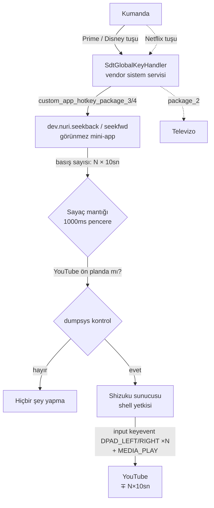

# Teknik Dokümantasyon

> **English:** [TECHNICAL.md](TECHNICAL.md)

Bu dosya projenin nasıl çalıştığını teknik kullanıcılar için açıklar: vendor tuş mekanizması, keşif yöntemi, mimari seçimler ve APK'ları kaynaktan derleme.

Test cihazı: **Skyworth UHD Google TV STB** (`HPR314-Next`/`RMQ`), Android 14.

## 1. Vendor hızlı tuş mekanizması

Kumandadaki marka tuşları standart Android input yolundan gitmez — erişilebilirlik (Accessibility) servisleri bu tuşları **göremez** (Key Mapper/Button Mapper ile yakalanamazlar). Tuşlar donanım katmanından doğrudan bir broadcast'e düşer:

- Sistem APK'sı: `/system/priv-app/SdtGlobalKeyHandler/SdtGlobalKeyHandler.apk`
- Receiver: `com.sdt.globalkey/.GlobalKeyReceiver`
- Intent action: `android.intent.action.GLOBAL_BUTTON`
- KeyEvent extra: `android.intent.extra.KEY_EVENT`
- Logcat etiketi: `SdtGlobalKey`

Handler, basılan keyCode'a göre kullanıcı atamasına bakar; atama yoksa gömülü fallback uygulamayı açar:

| KeyCode | Slot ayarı | Fallback |
|---|---|---|
| 265 | `custom_app_hotkey_package_2` | Netflix (`com.netflix.ninja`) |
| 266 | `custom_app_hotkey_package_1` | YouTube (`com.google.android.youtube.tv`) |
| 138 | `custom_app_hotkey_package_3` | Prime Video (`com.amazon.amazonvideo.livingroom`) |
| 136 | `custom_app_hotkey_package_4` | Disney+ (`com.disney.disneyplus`) |

Atama, **paket adı** yazılarak yapılır; handler `getLaunchIntentForPackage` ile MAIN/LAUNCHER activity'yi bulur ve başlatır. `null` veya geçersiz değer → fallback çalışır. "Hiçbir şey yapma" seçeneği yoktur; bu yüzden boşa çıkarmak için **görünmez mini-app** atanır.

### Kendi tuşlarınızı keşfetme

```bash
adb logcat | grep -aE 'SdtGlobalKey|GLOBAL_BUTTON'
# Kumandadan sırayla her kısayol tuşuna basın:
#   onReceive:keyAction<1> keyCode: 138
#   UserSelectPkg=dev.nuri.seekback    (atanmışsa)
```

## 2. Neden Shizuku?

Hedef, YouTube içinde geri/ileri sarma yaptırmak. Denenen/elenen yollar:

| Yaklaşım | Sonuç |
|---|---|
| `dispatchMediaKeyEvent` (MEDIA_REWIND/FF) | YouTube Android TV **MediaSession yayınlamıyor** (`dumpsys media_session` → "Media button session is null") — komut boşa gider |
| Accessibility servisi tuş yakalama | Vendor tuşları a11y filtresini atlar, `GLOBAL_BUTTON` broadcast'e gider — yakalanamaz |
| `sendevent` / `/dev/input` | Root + SELinux gerekir |
| `Runtime.exec("input keyevent")` | `INJECT_EVENTS` yalnızca shell/system uid'ye verilir, normal app reddedilir |
| Self-ADB (app'in 127.0.0.1:5555'e bağlanması) | El yazımı ADB wire protocol mümkün ama RSA imza/handshake detayları adbd sürümüne göre hassas — bu projede kararsız bulundu |
| PC'de daemon + HTTP köprüsü | Çalışır (`scripts/tvseek_daemon.py`) ama PC'nin açık olmasını gerektirir |
| **Shizuku + `input keyevent`** | ✅ Tek kalıcı çözüm: box'a bir kez adb ile başlatılır, sonra shell-uid yetkisiyle `newProcess` çalıştırır; PC/ağ gerekmez |

Enjekte edilen `input keyevent 21/22` (DPAD_LEFT/RIGHT) doğrudan input pipeline'a girer → odaktaki uygulamaya gerçek kumanda basışı gibi ulaşır → YouTube ~10sn sarar. `MEDIA_PLAY` (126) sarma sonrası oynatmayı sürdürür; `DPAD_CENTER` (23) kullanılmaz çünkü YouTube'da kontrol panelini açar.

## 3. Uygulama mimarisi

Her mini-app tek bir `MainActivity` içerir:

```text
onCreate → StrictMode gevşet → basış sayacını oku (SharedPreferences)
       → 1000ms bekle → bu arada yeni basış geldiyse çık (sayaç+bekleme sıfırlanır)
       → yoksa sayaç kadar DPAD burst üret (N basış → N×DPAD → N×10sn)
       → Shizuku.newProcess("sh -c 'dumpsys...|grep -q youtube.tv || exit 0; input keyevent ...; input keyevent 126'")
       → finish()
```

Sarma komutunun başındaki `dumpsys activity activities | grep topResumed | grep -q com.google.android.youtube.tv || exit 0` satırı, ön plan uygulaması YouTube değilse hiçbir şey yapmadan çıkar — tuşlar yalnızca YouTube'da aktiftir.

- `Theme.NoDisplay` — pencere açmaz, zorunlu olarak `onCreate` içinde `finish()` çağrılır (aksi halde `IllegalStateException`).
- Manifest'te `rikka.shizuku.ShizukuProvider` + `moe.shizuku.manager.permission.API_V23` izni gerekir.
- `Shizuku.newProcess` v13 API'sinde private — resmi pratik: reflection ile çağırmak.
- `Shizuku.requestPermission(0)` ilk basışta manager diyaloğu açar; "her zaman izin ver" ile kalıcıdır.
- Basış penceresi 1000ms: son basıştan 1000ms sonra SharedPreferences'taki `last` hâlâ kendi timestamp'imizse toplam `cnt` kadar sararız; yeni basış gelirse `last` güncellendiği için eski bekleme iptal olur (sayaç + bekleme fiilen sıfırlanır).

## 4. Kaynaktan derleme

Gereksinimler: JDK 17+, Android SDK `platforms/android-34/android.jar` ve `build-tools/34.0.0` (`aapt2`, `apksigner`, `d8.jar`).

Shizuku bağımlılıkları (Maven Central, `dev.rikka.shizuku:13.1.5`): `api`, `provider`, `shared`, `aidl` AAR'ları — her birinden `classes.jar` çıkarılır.

```bash
# scripts/build.sh — örnek derleme hattı
AJAR=/path/to/platforms/android-34/android.jar
BT=/path/to/build-tools/34.0.0
JARS="shizukuapi/classes.jar shizukuprov/classes.jar shizukushared/classes.jar shizukuaidl/classes.jar"

javac -nowarn -cp "$AJAR:$SHZ_API" -d build/seekback/classes src/seekback/MainActivity.java
java -cp $BT/lib/d8.jar com.android.tools.r8.D8 --lib $AJAR --min-api 23 \
    --output build/seekback build/seekback/classes/... $JARS
$BT/aapt2 link -o build/seekback/app-unsigned.apk \
    --manifest src/seekback/AndroidManifest.xml -I $AJAR
cd build/seekback && zip app-unsigned.apk classes.dex
$BT/apksigner sign --ks debug.keystore --ks-pass pass:android \
    --out seekback.apk app-unsigned.apk
```

Keypair: `keytool -genkey -v -keystore debug.keystore -alias androiddebugkey -keyalg RSA -keysize 2048 -validity 10000` (parola `android`).

## 5. Alternatif: PC-daemon köprüsü

`scripts/tvseek_daemon.py` — PC'nin adb bağlantısını köprü olarak kullanır. Mini-app `http://PC-IP:7575/back|fwd` çağırır, daemon `adb shell input keyevent 21/22` çalıştırır. Sadece `BOX_IP`'den gelen istekleri kabul eder. PC sürekli açıksa basit bir alternatif; yoksa Shizuku yolu tercih edilir.

## 6. Bilinen sınırlar

- Sarma adımı YouTube TV'nin kendi davranışıdır (~10sn/DPAD basışı); 5sn gibi ara değer yoktur.
- Shizuku sunucusu box yeniden başlatıldığında durur → tek komutla tekrar başlatılır (README adım 3). Kalıcı hale getirmek için `BOOT_COMPLETED` alıcısı ile `libshizuku.so` tetiklenebilir ama starter shell uid'de çalışmalı — pratik yöntem kullanıcının bir kez adb çalıştırmasıdır.
- Tuşlar her zaman vendor handler'a uğrar; mini-app her basışta çalışır ama enjekte etmeden önce shell içinde `dumpsys` ile ön plan paketini kontrol eder — YouTube açık değilse komut sessizce çıkar. YouTube'da arka plan/arama gibi ekranlarda da `topResumed` YouTube paketini gösterir, yani sarma tuşları YouTube'un her ekranında aktiftir.

## 7. Akış diyagramları

### Genel bakış



### Detaylı akış

```mermaid
sequenceDiagram
    participant K as Kumanda
    participant V as SdtGlobalKeyHandler<br/>(system uid)
    participant A as seekback/seekfwd<br/>(Theme.NoDisplay)
    participant SP as SharedPreferences<br/>(sayaç)
    participant SZ as shizuku_server<br/>(shell uid)
    participant Y as YouTube

    K->>V: Marka tuşu (keyCode 136/138)
    V->>V: custom_app_hotkey_package_X oku
    V->>A: MAIN activity başlat
    A->>SP: cnt oku/artır, last=now
    A->>A: Thread.sleep(1000)
    A->>SP: last == now ?
    alt 1sn içinde yeni basış geldi
        Note over A,SP: last değişti → bu çağrı iptal<br/>(yeni çağrı devralır)
    else son basış buydu
        A->>SZ: newProcess("sh -c 'dumpsys...youtube.tv<br/>|| exit 0; input 21 ×cnt; input 126'")
        SZ->>SZ: Ön plan YouTube kontrolü
        alt YouTube ön planda
            SZ->>Y: DPAD_LEFT/RIGHT ×N (N×10sn sar)
            SZ->>Y: MEDIA_PLAY (oynatmayı sürdür)
        else YouTube değil
            SZ-->>A: exit 0 (sessizce çık)
        end
    end
    A->>A: finish() → process kapanır
```
